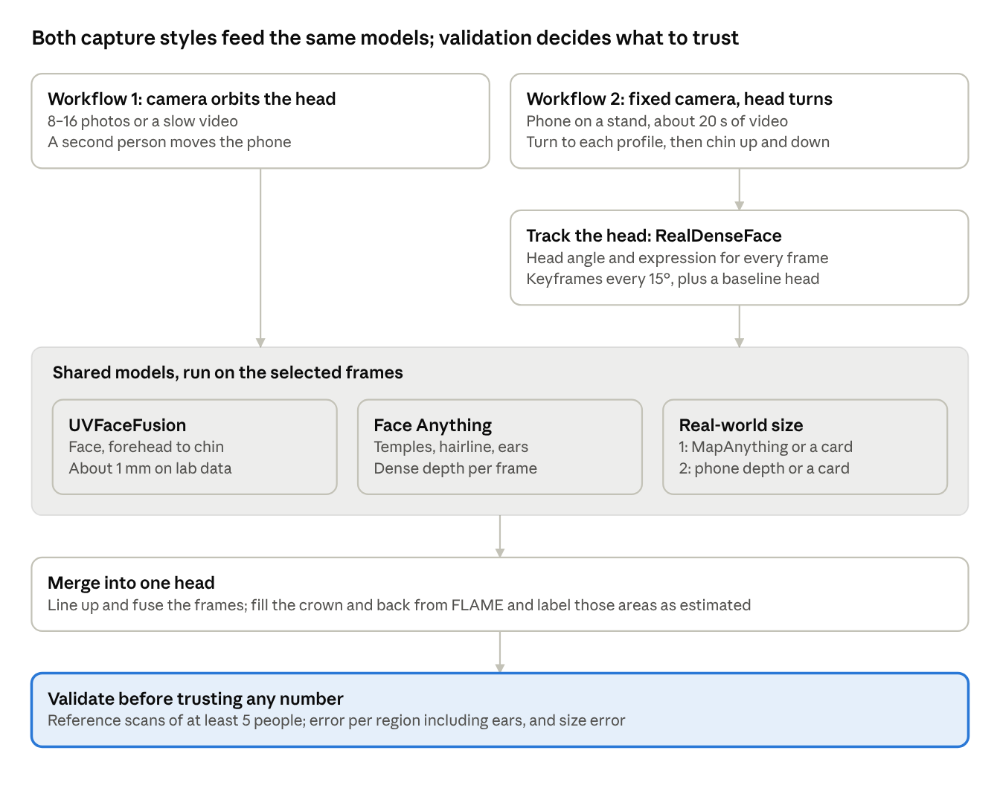

# Open Multi-View 3D Face & Head Reconstruction Models (2024–2026)

As of Oct 22, 2026. Live version with comments: https://claude.ai/artifact/EPgLDnDXu1JSyhwPEgePuw

## TL;DR

For non-commercial research, both capture styles can be built from open models. **UVFaceFusion** gives the most accurate measured face (orbit capture, lab data), **Face Anything** adds temples and ears, and the fixed-camera head turn also needs **RealDenseFace** to track the head.

- **Workflow 1, the camera moves around a still head:** [UVFaceFusion](https://github.com/grignarder/UVFaceFusion) for the face (about 1 mm from 4–16 photos, on lab data). Add [Face Anything](https://github.com/kocasariumut/FaceAnything) for temples, hairline and partial ears, and [MapAnything](https://github.com/facebookresearch/map-anything) or a card for real-world size.
- **Workflow 2, a fixed camera while the person turns their head:** [RealDenseFace](https://github.com/LinzhouLi/RealDenseFace) tracks the head and gives a baseline full head, Face Anything supplies dense shape, and UVFaceFusion refines the face. Nobody has measured accuracy on ±90° turns yet; plan for roughly 1–2 mm on the face until you validate it.
- **Phone depth helps most in workflow 2.** Two studies with a fixed iPhone front depth sensor at about 30 cm reached 0.86 mm average surface error (RMS) with a head turn, and 1.47 mm with the person on a swivel chair. They used commercial scanning apps, not learned models.
- **Weakest everywhere: ears and real-world size.** MapAnything estimates size but is untested on heads, so confirm it with phone depth or a card.
- **Licences:** non-commercial use clears most limits. Sapiens2 stays excluded because its licence bans biometric processing, and FLAME (the standard statistical head model most face methods build on) needs a free academic registration.
- **Coverage:** two research rounds; 84 models checked against GitHub, arXiv and Hugging Face, and the code of 10 repos read for the head-turn case. Several of 2026's most relevant papers, such as Google's SHELLS and Apple's HeadsUp, publish no code or weights.

## Scope and selection criteria

A model made the list only if it passed the four filters below; two borderline building blocks are marked as such. Everything else is listed under Excluded with the reason.

| Filter | Rule |
| --- | --- |
| Recency | First public release (arXiv v1 or first code drop) on or after 2024-10-22, i.e. within the last 2 years |
| Open code | Inference code is public |
| Open weights | Pretrained checkpoints can be downloaded today (gated or sign-up is noted, "coming soon" does not count) |
| Learned at scale | A network trained on a large dataset, not a per-person optimisation with no pretrained model |

Ranking then weighed four things: how well the model uses several photos at once, how faithful the shape is (not just a nice-looking avatar), coverage from forehead and temples down to the chin and out to the ears, and how easy it is to run (license, dependencies, maturity, GPU cost).

Two capture styles were studied: a phone moved around a still head (8–16 photos or a short video), and a fixed phone while the person turns their head. The project is non-commercial, so CC BY-NC and similar research licences are acceptable. Fourteen lower-relevance generic or generative models were found but not checked one by one: Fast3R, CUT3R, MV-DUSt3R+, MUSt3R, Fin3R, FLARE, HAMSt3R, PEAR, RecGen3D, MV-SAM3D, SAM 3D Body, SyncHuman, DiffPortrait360 and UMI3D.

## Comparison of the qualifying models

Only two models reconstruct a face from several unposed photos and report millimetre shape accuracy on real people: UVFaceFusion and its predecessor VGGTFace. Both stop in front of the ears and lose real-world size.

Rows follow the first-round ranking, made before the project was confirmed non-commercial; the workflow sections give the current picks. Accuracy figures use each paper's own metric and benchmark, so they are not directly comparable. Most were measured after rescaling the result onto the scan, which hides errors in absolute size. "Unposed" means camera positions are unknown; "metric" means real-world units. NeRSemble, H3DS and NoW are benchmarks built from studio scans. "Commercial" is for reference only, since this project is non-commercial: it means usable in a paid product without extra licences.

| Model | Released | Photos in | What it outputs | Best reported accuracy | Commercial |
| --- | --- | --- | --- | --- | --- |
| [UVFaceFusion](https://github.com/grignarder/UVFaceFusion) (Tsinghua) | 2026-07 | 4–16 unposed, native | Face mesh, forehead to chin, stops in front of ears; not to scale | 0.91 mm NeRSemble, 1.12 mm H3DS (16 views); 1.06 / 1.31 mm (4 views) | No |
| [MapAnything](https://github.com/facebookresearch/map-anything) (Meta) | 2025-09 | Any number, unposed, native | Cameras plus metric point cloud of everything visible, ears included | No face benchmark | Yes (map-anything-apache checkpoint only) |
| [GNM Head](https://github.com/google/GNM) (Google) | 2026-07 | None; a shape model you fit | Metric full-head model with ears, 17,821 vertices | 0.75 mm fit to 15,000 held-out scans (FLAME 0.97 mm); no accuracy from photos | Yes, Apache-2.0 |
| [RealDenseFace](https://github.com/LinzhouLi/RealDenseFace) (Zhejiang) | 2026-08 | 1 image (optional multi-photo FLAME fit) | FLAME full head; ears and skull from the prior | 1.61 mm NeRSemble single-view (rank 1, with MICA, which the release lacks) | No |
| [VGGTFace](https://github.com/grignarder/vggtface) (Tsinghua) | 2025-11 | Up to 16 unposed, native | Face mesh only; not to scale | 0.98 mm NeRSemble, 1.18 mm H3DS | No |
| [Pixel3DMM](https://github.com/SimonGiebenhain/pixel3dmm) (TUM) | 2025-05 | 1 image (optional multi-photo FLAME fit) | FLAME full head; ears and skull from the prior | 1.66 mm NeRSemble single-view; NoW 0.87 mm median | No |
| [Face Anything](https://github.com/kocasariumut/FaceAnything) (TUM) | 2026-04 | Many unposed, native | Per-photo face depth incl. hair and visible ears; no mesh | Best face depth on NeRSemble and Ava-256 | No |
| [VGGT](https://github.com/facebookresearch/vggt) (Meta, Oxford) | 2025-03 | Unposed, native | Cameras plus point cloud; not to scale | Backbone of both top face methods | Yes, Commercial checkpoint |
| [MOCHI](https://github.com/filby89/mochi) (Athena, MPI) | 2026-05 | Calibrated studio rig | Metric FLAME full head incl. ears | 0.26 mm median, FaMoS studio data | No |
| [MATCH](https://github.com/malteprinzler/match) (ETH, Google) | 2026-03 | Calibrated studio rig | Full head incl. ears | 0.88 mm face, 2.10 mm full head, Ava-256 | No |
| [DAViD](https://github.com/microsoft/DAViD) (Microsoft) | 2025-07 | 1 image | Per-photo relative depth and normals | Normals 17.2° mean error, Goliath-Face | Yes, MIT |
| [KaoLRM](https://github.com/CyberAgentAILab/KaoLRM) (CyberAgent) | 2026-01 | 1 image | FLAME head | NoW val 0.99 mm | No |
| [SHeaP](https://github.com/nlml/sheap) (Toyota, TUM) | 2025-04 | 1 image | FLAME head | NoW 0.95 mm median | No |
| [DenseMarks](https://github.com/diddone/densemarks) (Pozdeev et al.) | 2025-11 | 1 image | Dense full-head correspondences incl. ears; no geometry | 2D only | No |

Every model above was first released after 2024-10-22 and has public code. Two are borderline inclusions: VGGTFace ships no trained network of its own (it optimises per person using VGGT and Pixel3DMM weights), and GNM Head is a statistical shape model, not an image model. MapAnything, VGGT and DAViD are generic building blocks, not face reconstructors. Head-avatar and image-to-3D generators that also passed are covered under Other candidates.

## Workflow 1: top picks when the camera moves around a still head

Pick UVFaceFusion for face accuracy, Face Anything for temples and ears, and MapAnything for cameras and real-world size. No single model does all of it.

### 1. UVFaceFusion: the most accurate face from several photos

[Paper](https://arxiv.org/abs/2607.18798) · [Code](https://github.com/grignarder/UVFaceFusion) · [Weights](https://cloud.tsinghua.edu.cn/f/a76f042852bb4191bf2f/) · Tsinghua University, July 2026

- **What it does:** turns 4–16 uncalibrated photos into one face mesh with a fixed 6,986-vertex layout, in under 3 s on an RTX 4090.
- **Why it wins:** best measured accuracy in the study: 0.91 mm on NeRSemble and 1.12 mm on H3DS with 16 views, 1.06 / 1.31 mm with 4 views. It beats VGGTFace, HRN, Pixel3DMM and DECA on the same benchmarks. Its trained fusion step adds measurable accuracy (1.22 mm without it on H3DS).
- **How it works:** VGGT estimates the cameras and depth for every photo. Pixel3DMM predicts which point of a standard face each pixel belongs to. A trained network merges all views in that shared face layout and outputs the mesh.
- **Coverage:** chin, jaw, cheeks, nose, lips, forehead up to about 6.5 cm above the eyes, and part of the temples. The mesh stops in front of the ears, and areas near the ears come from the template, not the photos. No ears, scalp or neck: the code masks ears and hair out of the input.
- **Risks:**
  - Output is not to scale; size must come from elsewhere.
  - Licences: GPL-3.0 code and CC BY-NC dependencies, fine for non-commercial research. The fusion weights have no licence stated, so ask the authors.
  - Young code: 7 commits, about 28 stars, "relatively messy" per its README.
  - Three bugs found by reading the code: it crops the image centre blindly, its face detector aborts the run on any frame with no face, and it only reads `.png` files, so phone `.jpg` photos fail. All are easy to patch.
  - The face network saw only 256 people from one studio rig. Expression changes between handheld shots will cost accuracy.
- **How to run:** clone the repo; download VGGT-1B and Pixel3DMM's `uv.ckpt` only (skip its FLAME and MICA steps); download `fusion_net.pth` (1.43 GB). Crop each photo around the face and save as `.png`, then run `preprocess.py` and `infer.py`. Output: `result.ply`. Needs a CUDA GPU (bf16 on Ampere or newer, fp16 otherwise).

### 2. Face Anything: temples, hairline and partial ears

[Paper](https://arxiv.org/abs/2604.19702) · [Code](https://github.com/kocasariumut/FaceAnything) · [Weights](https://huggingface.co/UmutKocasari/FaceAnything) · TUM, April 2026, ECCV 2026

- **What it does:** takes many unposed photos or video frames at once and predicts depth for each, the cameras, and a coordinate on a neutral-expression face model for every pixel.
- **Why it is now a pick:** it has the best published face depth (NeRSemble relative error 0.040 vs 0.048 for Sapiens-2B), and its error falls sharply with more views. Its depth covers temples, hairline and visible ears, which UVFaceFusion leaves out. It was ruled out before mainly because it is CC BY-NC.
- **Risks:** point clouds only, so you write the merging step. Size is a learned estimate, not measured. Its training cameras covered only about ±47° left to right, so ears and the sides of the head are noisy. No millimetre accuracy has been published for its shape. 15.5 GB checkpoint; about 19 GB of GPU memory for 40 frames.
- **How to run:** `run_inference.py` on a folder of frames with `--use-predicted-poses`, so all frames share one coordinate frame. Spread frames over the whole capture (its loader keeps only the first `--max-frames`), use one fixed face crop, and read `raw_predictions.npz`.

### 3. MapAnything: cameras and real-world size

[Paper](https://arxiv.org/abs/2509.13414) · [Code](https://github.com/facebookresearch/map-anything) · [Weights](https://huggingface.co/facebook/map-anything) · Meta and CMU, September 2025

- **What it does:** from unposed photos it predicts every camera and a point cloud in real-world units, ears and sides of the head included.
- **Role:** sets the size of the face mesh and cross-checks the cameras. Use the CC BY-NC weights (`facebook/map-anything`): they were trained on 13 datasets, including some with people and motion, against 6 static datasets for the Apache version.
- **Risks:** not trained on faces, so facial detail is smooth. Its size accuracy at head distance is untested, so cross-check it with a card. Input is 518 px.
- **How to run:** `pip install -e .` from the repo, then `MapAnything.from_pretrained("facebook/map-anything")` and `model.infer(views)`. Pass the phone's focal length, and phone depth if you have it.

### Completing the full head

- **RealDenseFace** ([code](https://github.com/LinzhouLi/RealDenseFace)) gives a full FLAME head, now usable for research; its ears and scalp come from FLAME's statistical model, not the photos. Its shape is used to fill the crown, back of the head and backs of the ears, which are labelled as estimated. Running its video tracker on the orbit video also gives a quick full-head baseline.
- **[GNM Head](https://github.com/google/GNM)** (Google, Apache-2.0, real-world scale, ears included) is the alternative if the project ever becomes commercial. Google ships no code to fit it to photos.

## Workflow 2: fixed camera, the user turns their head

It can work, but no model has been measured on ±90° head turns yet. Use RealDenseFace to track the head, Face Anything for dense shape out to the ears, and UVFaceFusion to refine the face. Plan for roughly 1–2 mm on the face until you validate it; this is an estimate, not a measurement.

### Why it is harder

- **Still background.** VGGT, MapAnything and similar models assume the camera moved. With a still background they lock onto the room and see the head as several rotated copies. Blacking out the background is outside their training data (VGGT issue #47 shows silhouettes being reconstructed instead).
- **Neck and torso** stay still while the head turns, and hair moves.
- **Expression, gaze and lighting** change from frame to frame as the face turns under fixed lights.
- **Profiles are brief.** Ears are visible only near ±70–90°. Face detectors in Pixel3DMM and UVFaceFusion fail on profiles and abort the whole run unless patched.

### Picks for this workflow

| Role | Model | Why it fits | Main work needed |
| --- | --- | --- | --- |
| Head pose and a baseline full head | [RealDenseFace](https://github.com/LinzhouLi/RealDenseFace), offline video tracker | Built for a fixed camera: one shared face shape, per-frame head pose and expression, and no pixel matching across frames, so the background cannot take over. 84 s for 1,862 frames on an RTX 4090. 1.69 mm on the face only, from 5 lab clips (turn range not stated; the paper's figures suggest ±30–40°) | Fix the focal length in its config; start the clip on a sharp frontal frame; add a mesh export (not saved by default); drop bad frames |
| Dense shape incl. temples and ears | [Face Anything](https://github.com/kocasariumut/FaceAnything) | Trained on clips where the head moves in front of a still camera; it predicts a still camera (0.054° error) instead of mistaking head motion for camera motion. Gives every pixel a neutral-expression face coordinate, so frames can be lined up without camera solving | Spread keyframes over the whole clip (its loader keeps only the first N); one fixed face crop; keep its default still-camera setting (no --use-predicted-poses here) and use the calibrated focal length; new registration and fusion code, about 5–8 days |
| Face refinement | [UVFaceFusion](https://github.com/grignarder/UVFaceFusion) | Lines up each frame with the face template on its own, so a camera locked on the background does not break it | Same fixes as workflow 1; pick 12–16 frames by angle with a neutral face; compare masked and unmasked input |
| Masks | [SAM 3](https://github.com/facebookresearch/sam3) plus a face parser ([SegFace](https://github.com/Kartik-3004/SegFace) or facer) | Separates head, ears, hair, neck and torso in every frame | Small wrapper; check against the tracked head outline |
| Backup tracker | [Pixel3DMM](https://github.com/SimonGiebenhain/pixel3dmm) video tracking | Same fixed-camera design, but 2,994 s vs 84 s on the same test | Fix its preprocessing crashes on profiles |

### Pipeline

1. Extract upright, un-mirrored frames and trim so the first frame is a sharp, frontal, neutral face. RealDenseFace takes its focal length, starting shape and face box from that frame.
2. Track the whole clip with RealDenseFace: head angle, position and expression per frame, plus a neutral FLAME head.
3. Build per-frame masks with SAM 3, the face parser and the tracked head: whole head, rigid areas (forehead, nose bridge, cheekbones, temples) and ears, with the neck cut off.
4. Pick keyframes in 15° steps from 0 to ±90°, plus chin up and down, choosing sharp frames with a neutral face: 30–40 for Face Anything, 12–16 for UVFaceFusion.
5. Run Face Anything on its keyframes without masks and with its default still-camera setting (unlike workflow 1, no --use-predicted-poses). Line each frame up through its face coordinates, starting from the RealDenseFace pose and using rigid areas only; drop frames that disagree by more than about 3–5°. Refine and merge the frames into one surface.
6. Run UVFaceFusion on its keyframes and use its face where it agrees with the merged surface within 1–2 mm.
7. Fill the unseen crown, back of the head and backs of the ears by fitting FLAME or GNM Head, and label those areas as estimated.
8. Set real-world size from a phone depth frame or a card or marker held at the face.
9. Validate against reference scans of at least 5 people before trusting any number.

Rough effort: 3–4 engineer-weeks on one NVIDIA GPU with 24 GB or more. Nothing has been run yet; there was no GPU in this review.

### Capture guidance

- **Setup:** phone on a stand at eye level, rear main camera, 0.6–0.8 m away, landscape, 60 fps (30 minimum). Lock focus, exposure and white balance; turn off stabilisation and zoom.
- **Calibrate the camera once** with a checkerboard. A wrong focal length distorts nose depth and face width, and size correction cannot fix it.
- **Light:** soft and even, from behind the phone.
- **Person:** hair tied back, glasses and earrings off, neutral face with lips closed, eyes looking straight ahead relative to the head, shoulders still.
- **Script, about 20 s:** frontal for 2 s, turn slowly (30°/s or less) to the left profile and hold 1 s, back through frontal to the right profile and hold 1 s, frontal, chin up about 20°, chin down about 20°.
- **Size reference:** a bank-card-sized card or an ArUco marker held under the chin for the first frontal seconds.
- **Before the person leaves:** check for a sharp frame beyond ±60° on each side and both ears visible. Record 2–3 takes.
- **Option:** sit the person on a swivel stool so head and torso turn together, which removes neck twist.
- **Front camera** only if on-screen prompts are needed: their eyes will follow the screen, and the video must be un-mirrored.

### Phone depth is a strong non-learned check

Two published studies used a fixed iPhone and its front depth sensor (TrueDepth) at about 30 cm, with commercial scanning apps:

- [Andrews et al., Heliyon 2023](https://pmc.ncbi.nlm.nih.gov/articles/PMC10172784/): phone on a stand at 30 cm, head turned left and right over about 14 s. Error 0.86 ± 0.31 mm RMS against a 3dMD scanner, 29 adults.
- [Bioengineering 2025;12(8):792](https://pmc.ncbi.nlm.nih.gov/articles/PMC12383923/): phone on a tripod, person rotated on a swivel chair. Error 1.47 mm RMS against cone-beam CT, 23 patients; largest errors at lateral landmarks (ear tragus, jaw angle, outer eye corner).

If iPhones are available, record a separate front-camera depth take per person at 30–40 cm, with an app that exports depth plus camera intrinsics. No app was evaluated here, so check one is still available. It gives real-world size and an independent check on the learned shape.

### Orbit vs head turn

|  | Workflow 1: camera orbits | Workflow 2: head turns |
| --- | --- | --- |
| Measured face accuracy | 0.91–1.12 mm (UVFaceFusion, 16 views, lab data) | None at ±90°; plan for about 1–2 mm |
| Ears | Seen from many angles | Seen only near ±70–90°, briefly |
| Real-world size | MapAnything or a card | One camera calibration; phone depth or a card |
| Main failure causes | Operator skill, blur, person swaying | Neck and torso, expression drift, missed profiles |
| Who can capture | Needs a second person | Self-serve on a stand |
| Extra engineering | Patches only | Patches plus registration and fusion code |

Use the orbit when someone can help and accuracy matters most. Offer the head turn for self-capture once it has been checked against orbit captures and reference scans of the same people. Both share most components, so supporting both costs little extra.

### Other models checked for the head turn

| Model | Verdict |
| --- | --- |
| [V-DPM](https://github.com/eldar/vdpm) (Oxford, CVPR 2026) | Experiment only: places every frame's head pixels at the frontal moment, but accurate to centimetres, not millimetres |
| [Any4D](https://github.com/Any-4D/Any4D) (CMU) | Head-pose cross-check only; demo needs fixes; centimetre-level depth |
| [Point4D](https://github.com/point-4d/Point4D) (CMU, Sep 2026) | Head-pose cross-check only; squashes portrait frames |
| [VGGT4D](https://github.com/3DAgentWorld/VGGT4D), [Trace Anything](https://github.com/ByteDance-Seed/TraceAnything) | Treat the head as moving content; experimental |
| [SpatialTrackerV2](https://github.com/henry123-boy/SpaTrackerV2) | Helper for lining up phone depth frames |
| [F2S](https://github.com/xingy038/F2S), [Prompt Depth Anything](https://github.com/DepthAnything/PromptDA) | Optional per-frame depth helpers |
| [flame-head-tracker](https://github.com/PeizhiYan/flame-head-tracker) | Excluded: first released before the cutoff and not a model trained at scale |

## Other candidates and why they ranked lower

RealDenseFace and Face Anything moved up to picks once non-commercial licences were allowed; their rows below list their limits. Everything else is either weaker on measured shape, needs a studio rig, or invents the parts it cannot see.

| Model | Best use here | Why not a top pick |
| --- | --- | --- |
| [RealDenseFace](https://arxiv.org/abs/2608.09238) | Now a pick: head tracker in workflow 2, full-head baseline in workflow 1 | Per-frame network; shape limited to FLAME, ears from the prior. Released version lacks the MICA step (2.09 mm vs 1.86 mm with it). In multi-photo mode only the first photo gets a full pose search; each later photo starts from the previous one's pose. Default focal range likely misses phone portraits. Released settings differ from the paper's |
| [VGGTFace](https://arxiv.org/abs/2511.20366) | None; superseded | Same authors as UVFaceFusion and worse on every benchmark (e.g. 1.18 vs 1.12 mm H3DS); no ears; repo frozen |
| [Pixel3DMM](https://arxiv.org/abs/2505.00615) | Its UV predictor runs inside UVFaceFusion | Paper says it cannot use multi-view information; multi-image mode is unbenchmarked. FLAME fits from many views reach only about 1.45 mm. Minutes per subject. CC BY-NC plus MICA and InsightFace at runtime |
| [Face Anything](https://arxiv.org/abs/2604.19702) | Now a pick in both workflows: temples, hairline and ears | Point clouds only, no mesh; size is a learned estimate; ears noisy beyond its ±47° training range; 15.5 GB checkpoint |
| [VGGT-1B-Commercial](https://huggingface.co/facebook/VGGT-1B-Commercial) | Camera and depth backbone, A/B against MapAnything | Not needed: use VGGT-1B, which UVFaceFusion's fusion network was trained on |
| [Depth Anything 3](https://arxiv.org/abs/2511.10647) (ByteDance) | A/B against MapAnything for cameras and shape | Only the large Nested model gives real-world size; worse face depth than VGGT, Sapiens and DAViD in Face Anything's tests |
| [VGGT-Ω](https://arxiv.org/abs/2605.15195), [π³ / Pi3X](https://arxiv.org/abs/2507.13347) | Stronger generic geometry | No face evidence, and faces were blurred or filtered out of VGGT-Ω's training data; experiment only |
| [MOCHI](https://arxiv.org/abs/2605.01450), [MATCH](https://arxiv.org/abs/2603.15811) | Full head incl. ears in a studio | Need calibrated, synchronised studio cameras; MATCH's ear correspondence error is 9.1 mm |
| [DAViD](https://arxiv.org/abs/2507.15365) | MIT per-photo normals as an extra fitting term | One photo at a time, relative depth only, no size; repo inactive since July 2025 |
| [MoGe-2](https://arxiv.org/abs/2507.02546) (Microsoft) | MIT backup to DAViD; estimates focal length when EXIF is missing | One photo at a time; no face evaluation |
| [DenseMarks](https://arxiv.org/abs/2511.02830) | Ear correspondences for fitting | No geometry of its own; extreme head turns are a stated weak point |
| [Sapiens2](https://arxiv.org/abs/2604.21681) (Meta) | None | Licence bans any use "for biometric processing" and restricts health inference; one photo at a time |
| [WorldMirror 2.0](https://arxiv.org/abs/2604.14268), [Hunyuan3D-2mv](https://arxiv.org/abs/2501.12202) (Tencent) | None | Licence excludes the EU, UK and South Korea, outputs included; health clauses; not to scale; Hunyuan3D invents unseen parts |
| OmniVGGT, HyDen, Dens3R | None | Generic scene models with no face evidence |
| SHeaP, KaoLRM, TEASER | Quick single-photo FLAME shape | One photo only; FLAME-limited (NoW about 0.92–0.99 mm median); TEASER has no licence at all |
| UIKA, FlexAvatar (Kirschstein et al.), FastAvatar (two papers), LAM, CAP4D, OMG-Avatar, LHM++ | Animated avatars | Optimised for how the head looks, not its shape; no geometry accuracy reported |
| FaceLift, HQ-Head, SOAP, TOPOS, TRELLIS, TRELLIS.2, ReconViaGen, LSRM, Pixal3D, SpinMeRound | Plausible full-head meshes | Generators that invent the sides, ears and back; scale normalised; no face accuracy reported |

## Excluded models

Several of the most relevant 2026 papers are not usable: most publish no code or no weights. Checked on 2026-10-22.

| Model | Released | Why excluded |
| --- | --- | --- |
| [SHELLS](https://arxiv.org/abs/2605.31283) (Google) | 2026-05 | Multi-view full head incl. ears, very relevant; no code or weights |
| [HeadsUp](https://arxiv.org/abs/2605.04035) (Apple) | 2026-05 | Multi-view Gaussian heads; no code or weights; needs a studio rig |
| [GHARP](https://arxiv.org/abs/2610.10945) (Apple) | 2026-10 | No code or weights; built on unreleased HeadsUp |
| [Skullptor](https://arxiv.org/abs/2602.21100) (Ubisoft) | 2026-02 | Maintainer confirmed the trained model will not be released |
| [GLVD](https://arxiv.org/abs/2510.06046) (Crisalix) | 2025-10 | Face shape for aesthetic medicine; no code or weights, private data |
| [CUBE](https://arxiv.org/abs/2604.12894) (Google) | 2026-04 | No code or weights |
| [Pix2NPHM](https://arxiv.org/abs/2512.17773) (TUM) | 2025-12 | Repo says "code coming soon"; no weights |
| [Avat3r](https://arxiv.org/abs/2502.20220) (TUM, Meta) | 2025-02 | Empty repo; no weights |
| [PercHead](https://arxiv.org/abs/2511.02777) (TUM) | 2025-11 | README-only repo for a year; single image |
| [Multiple View Neural Regression](https://arxiv.org/abs/2608.22655) (Clemson) | 2026-08 | Dissertation; no code, proprietary data |
| [ProfileSynth](https://arxiv.org/abs/2605.01746) (Keio) | 2026-05 | "Code coming soon"; small synthetic training set |
| [FNR2R](https://arxiv.org/abs/2601.01950) (Tianjin) | 2026-01 | Face normals only; small-data method, not trained at scale |
| [Pippo](https://github.com/facebookresearch/pippo) (Meta) | 2025-02 | Code only, no pretrained weights per its README; outputs images, not 3D |

Head-avatar papers with no code or weights: FlexAvatar (Peng et al.), FFAvatar (two different papers), FastGHA, MeshLAM, FHAvatar, SpatialAvatar-0, FA-LAM, FiCA, 3DRealHead, Any3DAvatar, BeautyNet. They also target appearance rather than measured shape. ImHead, a full-head shape model (ICCV 2025), released only a dataset, with no model or code.

Too old (first released before 2024-10-22), even though widely used: DECA, EMOCA, MICA, HRN, 3DDFA-V3, SMIRK, MonoNPHM, DUSt3R, MASt3R, Sapiens v1, GAGAvatar and VHAP. Several of them are still used inside the newer models listed above.

## Licence conditions for non-commercial use

For non-commercial research, every model in the comparison table can be used, except that UVFaceFusion's fusion weights carry no licence: get the authors' terms in writing. A few conditions still apply.

- **Check that the project counts as non-commercial.** CC BY-NC defines it as use "not primarily intended for or directed towards commercial advantage or monetary compensation". R&D inside a company that feeds a future product may not qualify, so a short legal check is worth it.
- **FLAME** (the face model behind Pixel3DMM, RealDenseFace, UVFaceFusion's template and most others) needs a free academic registration at [flame.is.tue.mpg.de](https://flame.is.tue.mpg.de/modellicense.html). Pixel3DMM also pulls MICA and InsightFace models, both research-only, which is fine here. RealDenseFace's weights embed Meta's DINOv3 (follow its terms and acknowledge it), and it needs NVIDIA's nvdiffrast, licensed for research and evaluation only. SAM 3 is gated and must be acknowledged in publications.
- **Still blocked even for research:** Meta's Sapiens2 licence bans biometric processing outright. Tencent's WorldMirror and Hunyuan3D cannot be used in the EU, UK or South Korea.
- **VGGT's acceptable use policy** (it covers the VGGT-1B model inside UVFaceFusion) bans inferring health information without legally required consent, and bans unlicensed medical practice. Collect consent from every person scanned.
- **Biometric data rules apply regardless of licence.** Face geometry is biometric data in many jurisdictions: get consent, limit retention, and seek ethics approval if participants are involved.
- **Fragile hosting.** UVFaceFusion weights sit on a Tsinghua share link; RealDenseFace, MATCH and MOCHI on Google Drive. Mirror them with checksums.
- **If the project ever becomes commercial,** the face models above need licences from their authors and MPI (FLAME). The licence-clean route is MapAnything's Apache weights plus GNM Head.

## Recommended pipeline and next steps

Build one pipeline with two front ends. The models, merging and validation are shared; the head-turn workflow adds head tracking with RealDenseFace.

Next steps (rough estimates, not measured):

1. **Week 1:** register for FLAME, request SAM 3 access (manual approval), ask the UVFaceFusion authors about their fusion weights, set up an NVIDIA GPU with 24 GB or more, and get ethics approval and consent. Process data locally, never on hosted demos.
2. **Week 1:** run UVFaceFusion, Face Anything and RealDenseFace on 10–20 internal captures of each workflow. Patch the crop, `.jpg` and profile-detection bugs first.
3. **Weeks 1–3:** collect reference scans, ears included, with a 3dMD system or a structured-light scanner: at least 5 people for a pilot, 15–30 for a fuller study. Record both capture styles and, where possible, an iPhone depth take of each person in the same session.
4. **Weeks 2–4:** build the merging step (line up frames, fuse, fill from FLAME). Both workflows use it.
5. **Weeks 3–5:** compare the workflows region by region against the reference scans and decide whether the head turn meets your accuracy target.
6. **Capture app:** add on-device checks for blur, a face found in every frame, and coverage beyond ±60° on each side, plus audio prompts for the head-turn script.

## Sources

All pages below were opened on 2026-10-22. Links for the other models are in the tables above.

- UVFaceFusion: [paper](https://arxiv.org/abs/2607.18798), [code](https://github.com/grignarder/UVFaceFusion), [licence](https://raw.githubusercontent.com/grignarder/UVFaceFusion/main/LICENSE), [weights](https://cloud.tsinghua.edu.cn/f/a76f042852bb4191bf2f/)
- MapAnything: [paper](https://arxiv.org/abs/2509.13414), [code](https://github.com/facebookresearch/map-anything), [Apache weights](https://huggingface.co/facebook/map-anything-apache), [licence fix, issue #139](https://github.com/facebookresearch/map-anything/issues/139)
- GNM Head: [paper](https://arxiv.org/abs/2607.23687), [code](https://github.com/google/GNM), [weights](https://huggingface.co/google/gnm-v3), [landmark mapping, issue #53](https://github.com/google/GNM/issues/53)
- VGGTFace: [paper](https://arxiv.org/abs/2511.20366), [code](https://github.com/grignarder/vggtface), [AAAI 2026](https://ojs.aaai.org/index.php/AAAI/article/view/37754)
- Pixel3DMM: [paper](https://arxiv.org/abs/2505.00615), [code](https://github.com/SimonGiebenhain/pixel3dmm), [weights](https://huggingface.co/SimonGiebenhain/Pixel3dmm)
- RealDenseFace: [paper](https://arxiv.org/abs/2608.09238), [code](https://github.com/LinzhouLi/RealDenseFace), [project page](https://gapszju.github.io/RealDenseFace/)
- Face Anything: [paper](https://arxiv.org/abs/2604.19702), [code](https://github.com/kocasariumut/FaceAnything)
- VGGT: [paper](https://arxiv.org/abs/2503.11651), [code](https://github.com/facebookresearch/vggt), [licence](https://raw.githubusercontent.com/facebookresearch/vggt/main/LICENSE.txt), [Commercial checkpoint](https://huggingface.co/facebook/VGGT-1B-Commercial)
- Depth Anything 3: [paper](https://arxiv.org/abs/2511.10647), [code](https://github.com/ByteDance-Seed/Depth-Anything-3)
- Sapiens2: [licence](https://github.com/facebookresearch/sapiens2/blob/main/LICENSE.md)
- Not released: [SHELLS](https://arxiv.org/abs/2605.31283), [HeadsUp](https://arxiv.org/abs/2605.04035), [HeadsUp repo (project page only)](https://github.com/apple/ml-headsup)
- [FLAME model licence](https://flame.is.tue.mpg.de/modellicense.html)

Added in round 2 (head-turn workflow):

- Face Anything: [weights](https://huggingface.co/UmutKocasari/FaceAnything)
- MapAnything: [non-commercial weights](https://huggingface.co/facebook/map-anything)
- RealDenseFace: [issue #1, focal-length range](https://github.com/LinzhouLi/RealDenseFace/issues/1), [issue #3, weights licence](https://github.com/LinzhouLi/RealDenseFace/issues/3)
- SAM 3: [code](https://github.com/facebookresearch/sam3), [weights](https://huggingface.co/facebook/sam3); SegFace: [code](https://github.com/Kartik-3004/SegFace)
- VGGT [issue #47](https://github.com/facebookresearch/vggt/issues/47) on masked backgrounds
- V-DPM: [paper](https://arxiv.org/abs/2601.09499); Any4D: [paper](https://arxiv.org/abs/2512.10935); Point4D: [paper](https://arxiv.org/abs/2609.09145)
- Phone-depth studies: [Andrews et al., Heliyon 2023](https://pmc.ncbi.nlm.nih.gov/articles/PMC10172784/), [Bioengineering 2025](https://pmc.ncbi.nlm.nih.gov/articles/PMC12383923/)
