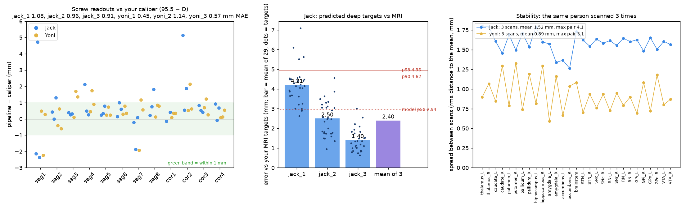

# Six app scans, Oct 23 2026: Jack ×3, Yoni ×3

Captures from the headscan iOS app: a TrueDepth face scan (no frame), then a helper orbit with the L116 frame on. After each scan the 12 screws were measured with a caliper. The pipeline ran blind: no caliper value went in.

## What ran

| Step | Tool | Where |
|---|---|---|
| Frame capture → poses, head mesh, screw + knob readouts | fast pipeline: tag poses, 7k Stochastic Solids, TSDF, CAD + image fits, calibrated readouts (`steps/app_stream.sh` → `fast_capture.sh`) | vast.ai RTX 4090, ~7 min per capture |
| Face scan → fine mesh | offline fine fusion of the TrueDepth raw data (headscan-app `scripts/spike/fine_fusion.py`) | Mac |
| Face landmarks | 478 FaceMesh points lifted from 15 renders of the fine mesh (hsbrain `facemesh3d`) | Mac |
| Face → head mesh (device frame) | vendored `align_face_scan.py` (face ICP, frame excluded) + atlas-weighted refinement when it passes its gates. For yoni_2 / yoni_3, where the FaceMesh start was ~45 mm off, the fit starts from yoni_1's placement through a face-to-face fit | Mac |
| Targets | tfus-simulation Ladder model "robust" (ear-seated frame: ear-ball width + 10 screw tips + face pose), fitted on all 336 CV heads (`scripts/robust_deploy.py`) | Mac |
| Jack's truth | MRI atlas targets (`results/me/targets_mri_mi.json`, provisional MI-SyN) → face scan through the atlas-weighted fit of the fine face to the MRI skin → device frame | Mac |

## Results

**Reconstruction.**
- Tag bundle adjustment: 0.41–0.52 px median.
- Full image fit: 0.76–1.01 px.
- Frame arches sit 1.2–1.6° and 3–4 mm off the CAD in every capture (flex or assembly, systematic).
- Fine face fusion residual: 0.44–0.63 mm.
- Not detected: the cor1 screw on jack_2 and the right knob on yoni_3. That knob was filled from Yoni's other scans.

**Screws vs caliper (gap = 95.5 − D, the calibration convention; the table used 96 − D).**

| | jack_1 | jack_2 | jack_3 | yoni_1 | yoni_2 | yoni_3 |
|---|---|---|---|---|---|---|
| MAE (mm) | 1.08 | 0.96 | 0.91 | 0.45 | 1.14 | 0.57 |
| within 1 mm | 9/12 | 9/11 | 8/12 | 11/12 | 6/12 | 11/12 |

- sag1 is wrong in 4 of 6 scans: −2.1 / +4.7 / −2.4 on Jack, −2.2 on yoni_2.
- cor2 reads +5.1 on jack_1.
- Today the uncalibrated (coarse) readings are as good or better (MAE 0.61–1.05 on Jack) than the thread-phase calibrated ones. The Oct 21 phase constants likely no longer fit the screws.

**Face alignment.**

| Fit | Median residual |
|---|---|
| Fine face → head mesh, Jack | 0.47–0.64 mm (p90 1.5–1.6) |
| Fine face → head mesh, yoni_1 | 0.59 mm |
| Fine face → head mesh, yoni_2 / yoni_3 (fallback) | 1.5 / 1.3 mm |
| Jack's fine face → his MRI skin, bony areas | 0.20–0.23 mm |
| Jack's face scans → each other, bony areas | 0.07–0.10 mm |

**Jack, 29 deep targets vs MRI.**

| | jack_1 | jack_2 | jack_3 | mean of 3 scans |
|---|---|---|---|---|
| Mean error (mm) | 4.21 | 2.50 | 1.40 | 2.40 |
| Percentile among the model's per-person errors (LOSO; p95 = 4.96 mm) | 83 | 35 | 3 | |
| Error with the caliper screw values (mm) | 3.64 | 1.24 | 1.97 | |

- **All three scans are within the model's p95.**
- The error is mostly a shift shared by all targets (4.0 / 2.2 / 0.9 mm); the scatter around that shift is 1.0–1.35 mm.
- The worst targets, averaged over scans, are brainstem (4.6 mm) and right thalamus (4.3 mm).
- **Truth uncertainty.** Changing the MRI-fit method moves the truth by about 0.6 mm (jack_1: 3.7–4.6 mm).
- **Placement check.** The front screw tips (sag2–sag4) land within about ±2 mm of the MRI skin.

**Stability between scans.** All predictions are mapped into scan 1's frame through face-to-face fits.

| | Jack | Yoni |
|---|---|---|
| Mean distance to the mean prediction | 1.52 mm | 0.89 mm |
| Worst pair (single target) | 4.1 mm | 3.1 mm |

**Sources of variation between sessions.**
- The frame sits differently each time. Jack's face pitch relative to the frame was −12.2 / −13.7 / −14.7°.
- The knob settings differ. Jack's ear-ball width (knob readings) was 130 / 124 / 123 mm.
- Yoni's inputs are at the edge of the training data:
  - ear-ball width 150–155 mm (training p95 147);
  - face pose z ≈ 3.

**Face landmarks vs the training heads.** Our scans' landmarks fit the training mean face at 5.7–6.4 mm rms. The training heads give 3.5 mm median and 6.7 mm at p99. This is the FaceMesh gap between real scans and MRI renders.

## Next

1. Screws:
   - recalibrate the thread phases, or read the coarse value;
   - check sag1's screw and tag;
   - cor1 on jack_2 and the right knob on yoni_3 were not seen.
2. Face → head alignment: make the FaceMesh start robust (it failed on 2 of 3 Yoni scans) and fix the weighted solver on Yoni (non-finite numbers).
3. Yoni's MRI, for his accuracy.
4. Training data: cover wider heads and face poses.

Data: `gdrive:frame_capture/app_scans_oct23/` (per capture: poses, mesh, fits, readouts; `analysis/`: eval.json, diag.json, landmarks, MRI fits, scripts).
